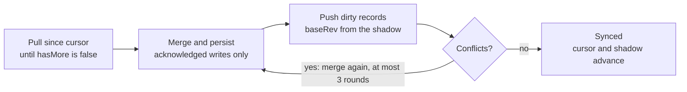
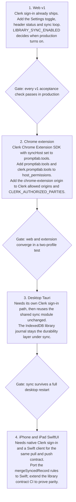

# Account library sync

Status: `draft`. Proposal recorded as D-016 in [DECISIONS.md](DECISIONS.md) and as DEC-87 in DB | Decisions. Nothing here ships until that decision is made. Written 2026-10-23 against `main` commit `f6fa3b6`.

PromptLab will sync each signed-in user's library to a Postgres copy keyed by their Clerk user ID, so the same prompts appear on every device. The device copy stays the working copy: localStorage and the IndexedDB journal keep serving reads and offline edits, while a background loop pushes and pulls changes one record at a time.

The server is a store with optimistic concurrency and no merge logic of its own. Conflicts resolve in the shared client code that already reconciles browser tabs, so one rule decides every case. Sync is opt-in, off by default, and ships behind a server kill switch, `LIBRARY_SYNC_ENABLED`.

Stack: Neon Postgres from the Vercel Marketplace, new Vercel functions under `api/library/`, and Clerk session JWTs checked by the existing `verifyClerkRequest`.

The build plan with per-slice Codex prompts is in [account-library-sync-slices.md](account-library-sync-slices.md).

## Goals and non-goals

v1 makes one library follow one account on the web shell, with no lost edits.

Goals:

- A signed-in user sees the same library, trash, collections and folders in every browser signed in to that account.
- Offline edits land on the next connection without overwriting a newer edit from another device.
- When two devices change the same prompt, the losing text survives as a version of the winner.
- Signed-out use works exactly as today, with zero requests to the sync API.
- One action turns sync off and deletes every server copy.

Non-goals for v1:

- Notebook pads (`pl2-pads`), experiment history, run logs and eval data. The `kind` column leaves room for them.
- Provider settings and API keys. These never leave the device.
- Sharing, team libraries and server search. The schema supports them; no routes ship.
- Live co-editing. Sync runs on events and a timer, not a socket.
- Sign-in for the extension, desktop and iOS shells. They follow the web rollout.
- Per-account namespacing of every local storage key.

## Current state

The local data model is already sync-shaped, so this work adds a transport and a server copy, not a new persistence layer. The shared frontend lives in `prompt-lab-extension/src` and ships to every shell.

| Area | What exists | File |
|---|---|---|
| Library storage | `pl2-library` (live) and `pl2-library-trash` (soft-deleted, 30-day retention) in localStorage | `prompt-lab-extension/src/lib/storage.js` |
| Collections and folders | `pl2-collections` holds names; `pl2-collection-folders` holds folders with ids | `prompt-lab-extension/src/lib/collectionFolders.js` |
| Record shape | Stable `id`, `updatedAt`, `deletedAt`, `tombstoneVersion`, up to 25 `versions` | `prompt-lab-extension/src/lib/promptSchema.js` |
| Merge rule | `reconcileLibraryRecords`: higher `tombstoneVersion` wins, then the newer clock. `stampRecordMutation` keeps clocks monotonic | `prompt-lab-extension/src/hooks/usePromptLibrary.js` |
| Permanent deletion | Append-only markers `pl2-library-deleted:<id>`; clear-all writes `pl2-library-clear:<generation>` | `prompt-lab-extension/src/lib/libraryDeletion.js` |
| Durability | Desktop journals the library to IndexedDB with strict commits | `prompt-lab-extension/src/lib/libraryJournal.js` |
| Starter packs | Seeded records get a random `id` per device, plus `metadata.packId` and `metadata.seedPromptId` | `prompt-lab-extension/src/lib/seedTransform.js` |
| Server auth | `verifyClerkRequest` returns `clerkUserId` from the JWT `sub` | `api/_lib/verifyClerkToken.js` |
| Route pattern | Web handler wrapped by `createNodeCompatibleHandler`, kill switch through `isFeatureEnabled`, shared CORS helpers | `api/billing/license.js` |
| Web token | The web shell passes Clerk's `getToken` into the shared app as `clerkGetToken` | `prompt-lab-web/app/main-web.jsx` |
| Policy | Sync between devices is export and import only; the privacy page says the library stays on the device | [LIBRARY_COMPATIBILITY_CONTRACT.md](LIBRARY_COMPATIBILITY_CONTRACT.md), `prompt-lab-web/public/privacy.html` |

Random starter IDs mean two devices that load the same pack hold different records for the same prompt. Sync must dedupe them (see Merge rules).

## Data model

Two tables. One row per account holds its revision counter; one row per synced record holds that record's latest state.

```sql
create table library_accounts (
  user_id     text primary key,            -- Clerk user id (JWT sub)
  rev         bigint not null default 0,   -- per-account monotonic counter
  enabled_at  timestamptz not null default now(),
  updated_at  timestamptz not null default now()
);

create table library_records (
  user_id           text not null references library_accounts(user_id) on delete cascade,
  kind              text not null check (kind in ('prompt', 'folder', 'collection', 'marker')),
  id                text not null,
  rev               bigint not null,
  body              jsonb,
  deleted_at        timestamptz,
  tombstone_version integer not null default 0,
  client_clock      timestamptz,
  device_id         text,
  updated_at        timestamptz not null default now(),
  primary key (user_id, kind, id)
);

create index library_records_user_rev on library_records (user_id, rev);
```

| kind | id | body | Local source |
|---|---|---|---|
| `prompt` | Prompt `id` | Full normalized entry, live or in trash | `pl2-library`, `pl2-library-trash` |
| `folder` | Folder `id` | Folder object | `pl2-collection-folders` |
| `collection` | Collection name | `{ "name": "..." }`; removal sets `deleted_at` | `pl2-collections` |
| `marker` | `deleted:<promptId>` or `clear:<generation>` | `null` | `pl2-library-deleted:*`, `pl2-library-clear:*` |

Rules:

- `user_id` comes only from the verified token. No request field sets it.
- Each accepted write takes the account's next `rev`. Pull returns rows with `rev` above the client's cursor, in order.
- A `deleted:<id>` marker also nulls that prompt row's `body` in the same transaction, so permanently deleted text leaves the server.
- A `clear:<generation>` marker nulls the body of every prompt row whose `metadata.libraryGeneration` is older, compared as strings the way `readLibraryDeletionState` does.
- Markers are never removed, matching the local append-only rule.
- One record body is capped at 256 KB.
- Migrations live in `db/migrations/`, starting with `0001_library_sync.sql`, applied by `npm run db:migrate` over `DATABASE_URL_UNPOOLED`. Functions connect over the pooled `DATABASE_URL` with `@neondatabase/serverless`.

## API contract

Three routes, all JSON, all behind `Authorization: Bearer <Clerk session JWT>` and the shared CORS helpers. `api/library/*.js` is registered in `vercel.json` with `maxDuration: 10`.

| File | Purpose |
|---|---|
| `api/library/pull.js` | `GET /api/library/pull` |
| `api/library/push.js` | `POST /api/library/push` |
| `api/library/index.js` | `DELETE /api/library` |
| `api/_lib/libraryStore.js` | SQL and transactions |
| `api/_lib/librarySync.js` | Validation, limits, `canUseLibrarySync` |

When `LIBRARY_SYNC_ENABLED` is off, every route returns `200 { "ok": true, "syncDisabled": true, "retryable": false }` and the client stops, mirroring `billingDisabledResponse`. `canUseLibrarySync(identity)` returns `true` for every signed-in account in v1; a later plan gate changes only that function.

### GET /api/library/pull

Query: `since` (default `0`), `limit` (default `500`, max `1000`). Returns records with `rev > since`, ascending. An account with no row gets `records: []` and `serverRev: 0`; pull never creates a row.

```json
{
  "ok": true,
  "records": [
    { "kind": "prompt", "id": "p_123", "rev": 41, "body": {}, "deletedAt": null, "tombstoneVersion": 0, "clientClock": "2026-10-21T13:02:11.000Z" }
  ],
  "nextSince": 41,
  "hasMore": false,
  "serverRev": 41
}
```

### POST /api/library/push

Up to 100 records and 1 MB per request. The first push upserts the `library_accounts` row.

```json
{
  "deviceId": "d_7f3c",
  "records": [
    { "kind": "prompt", "id": "p_123", "baseRev": 40, "body": {}, "deletedAt": null, "tombstoneVersion": 0, "clientClock": "2026-10-21T13:02:11.000Z" }
  ]
}
```

One transaction per request:

1. Lock the account row with `select ... for update`.
2. For each record, compare `baseRev` with the stored `rev`. A missing row expects `baseRev: 0`.
3. On a match, write the record with the next `rev`. On a mismatch, write nothing for it and return the server copy as a conflict.
4. Markers skip the check: insert if absent, always accepted, idempotent.

```json
{
  "ok": true,
  "accepted": [ { "kind": "prompt", "id": "p_123", "rev": 42 } ],
  "conflicts": [
    { "kind": "prompt", "id": "p_456", "server": { "rev": 39, "body": {}, "deletedAt": null, "tombstoneVersion": 1, "clientClock": "2026-10-21T12:58:40.000Z" } }
  ],
  "serverRev": 42
}
```

### DELETE /api/library

Deletes the account row; the cascade removes every record. Returns `{ "ok": true, "deleted": true }`. Local data is untouched.

### Errors and limits

Error bodies are `{ "ok": false, "error": "<message>", "retryable": <bool> }`. Rate limit: 120 requests per minute per account across all library routes, counted in Upstash Redis with the `incr` and `expire` pattern from `telemetryStore.js`. Preview has no Redis variables, so the limit is skipped when they are absent outside Production and fails closed with 503 when they are absent in Production.

| Status | When | Client action |
|---|---|---|
| 400 | Bad JSON, unknown `kind`, missing `id`, record over 256 KB | Drop the record, log it, show a sync error |
| 401 | Missing or invalid token | Refresh the token once, then pause sync and prompt sign-in |
| 403 | `canUseLibrarySync` is false | Turn the toggle off and explain why |
| 413 | Over 100 records or 1 MB | Split the batch and retry |
| 429 | Over the rate limit | Wait for `Retry-After` |
| 500, 503 | Database or server failure | Exponential backoff |

## Merge rules

The client merges; the server only refuses stale writes. Every conflict runs through one shared function, `mergeSyncedRecord(local, server)`, built on the ordering `reconcileLibraryRecords` already uses between tabs.

Prompts:

1. Higher `tombstoneVersion` wins, so a delete or restore beats an older edit.
2. Equal tombstones: the newer clock wins, where clock is `deletedAt || updatedAt || createdAt` (the existing `recordClock`).
3. Equal clocks: the server copy wins, so every device picks the same result.
4. If winner and loser content differ (`arePromptSnapshotsEqual` is false) and the loser is not already in the winner's `versions`, append the loser with `appendVersionSnapshot`, then stamp with `stampRecordMutation`. The existing 25-version cap applies.
5. If the merged record differs from the server copy, push it with `baseRev` set to the server `rev`. If it matches, adopt it locally and push nothing.
6. Retry conflicts at most 3 rounds per sync pass, then surface a sync error.

A trashed winner keeps the losing edit in its versions, so restoring from trash recovers it.

Folders and collections:

- Folders: the newer `clientClock` wins; a tie goes to the server. Removing a folder pushes it with `deletedAt`.
- Collections: one record per name. Removal sets `deletedAt`; adding the name again clears it with a newer clock.

Markers:

- Markers union and never conflict.
- A pulled `deleted:<id>` applies through the existing `markLibraryDeleted`; a pulled `clear:<generation>` applies through `filterDeletedLibraryRecords`.

Starter pack duplicates:

- Change `seedToEntry` to give starter records a fixed id, `starter:<packId>:<seedPromptId>`, whenever `seedPromptId` exists. Loads on two devices then land on one record.
- Before a record's first push, collapse untouched random-id starter copies into the fixed id. Untouched means no `versions`, `useCount` 0, and title and text equal to the seed.
- Only never-pushed copies collapse, so a dedupe can never purge a record another device has seen. Edited copies keep their own ids.
- When a pulled starter record's `packId` is missing from `pl2-loaded-packs`, add it so the Starter Packs card stops offering that pack.

## Client sync loop

A new shared module, `lib/librarySync.js`, and a `useLibrarySync` hook own the loop. They change the library only through the existing acknowledged writers, never raw localStorage, so the journal, storage events and save receipts keep working.

| Key | Holds |
|---|---|
| `pl2-sync:<userId>:state` | `{ enabled, cursor, deviceId, lastSyncAt, lastError }` |
| `pl2-sync:<userId>:shadow` | `kind:id` mapped to `{ rev, hash }` for the last copy the server confirmed |

A record is dirty when its hash differs from its shadow entry or it has no entry. The hash is SHA-256 over stable JSON of the normalized record, excluding derived fields such as `completeness`. Dirtiness comes from the shadow, not a queue, so an offline edit cannot be dropped.

One pass:



1. Take the Web Lock `pl2-library-sync`, so one tab per browser syncs. Other tabs adopt its writes through the existing storage-event listener. Without Web Locks, only a visible tab syncs.
2. Pull from the cursor until `hasMore` is false. Merge each record, persist it, then advance the shadow and cursor.
3. Push dirty records in batches of 100, with `baseRev` from the shadow (`0` when absent).
4. Accepted records update the shadow. Conflicts merge, persist, and queue again.
5. Repeat steps 2 to 4 until nothing is dirty, at most 3 rounds.

The cursor and shadow move only after the local write is acknowledged. Each request calls `clerkGetToken()` for a fresh session token.

| Trigger | Delay |
|---|---|
| Local library write (`onLocalWrite`) | 2 s debounce |
| Tab becomes visible, window focus, `online` event | Immediate |
| Timer while the tab is visible | Every 60 s |
| Sign-in, or the toggle turned on | Immediate |

Failures back off 5 s, 15 s, 60 s, then every 5 min, and reset on success. The Library header shows one state: Synced, Syncing, Offline, or Sync paused with a Retry action.

## Opt-in and first sign-in

Sync stays off until the user turns it on, so nobody sees a change on deploy day. The control lives in a new Account sync section of `prompt-lab-extension/src/modals/SettingsModal.jsx`, shown only when signed in and the server is not `syncDisabled`.

- Toggle: "Sync library to my account", off by default for every account.
- One line under it: what syncs (prompts, trash, collections, folders) and what never does (API keys, provider settings).
- Button: "Delete synced data".

First enable on a device:

1. Pull everything from `since=0`.
2. Collapse never-pushed starter duplicates.
3. Union by id. Server-only records land locally, local-only records queue for push, shared ids merge by the Merge rules.
4. Push the result.
5. Show a one-time summary, for example "Added 12 from your account, uploaded 30, merged 2."

No dialog is needed for collisions. Every one resolves by rule, and the losing text stays in versions.

Account switching: sync state is keyed by user id. If a browser already holds an enabled `pl2-sync:<otherId>:state` for a different account, first enable stops and asks: "This browser's library is synced to another account. Merge it into this account?" Merge continues the steps above; Cancel leaves sync off.

Turning it off:

- Signing out stops the loop. The local library and sync keys stay for that account's return.
- Turning the toggle off stops the loop and keeps the server copy.
- Delete synced data confirms first ("Your prompts stay on this device"), calls `DELETE /api/library`, then removes that account's sync keys.

## Security, privacy and policy

The token decides whose data a request touches, nothing secret enters a payload, and the policy pages change before the toggle appears in production.

Trust boundary:

- Every route calls `verifyClerkRequest`; `user_id` is its `clerkUserId`. No request can name another account.
- `CLERK_AUTHORIZED_PARTIES` stays enforced. Add each extension origin when the extension ships.
- The server accepts only the four kinds, ids up to 200 characters, and bodies up to 256 KB.
- Logs carry counts, status codes and timings, never record bodies.
- Database credentials live only in Vercel env vars (`DATABASE_URL`, `DATABASE_URL_UNPOOLED`), marked sensitive. Neon region: US East (N. Virginia).

Never syncs: the push builder reads only library, trash, folders, collections and markers. A test asserts no payload carries `pl2-provider-settings`, billing or telemetry data, or a string shaped like a provider key (for example `sk-`).

Policy changes, shipped before the toggle is visible:

| Document | Change |
|---|---|
| `prompt-lab-web/public/privacy.html` and `../docs/privacy.html` | Add an Account sync section: what is stored, where, that it starts only after opt-in, and how Delete synced data works |
| `prompt-lab-web/public/terms.html` | Name account sync storage under data handling |
| [LIBRARY_COMPATIBILITY_CONTRACT.md](LIBRARY_COMPATIBILITY_CONTRACT.md) | Replace export/import-only sync with opt-in account sync on signed-in web. Export and import stay for cross-account moves |
| [DECISIONS.md](DECISIONS.md) | D-016 resolved: account library sync on Neon Postgres, superseding the export/import-only rule |
| [ARCHITECTURE.md](../ARCHITECTURE.md) | Persistence section: server copy, routes, kill switch |

Retention and deletion wording goes to counsel review before deploy, like the current privacy drafts. Neon keeps a 6-hour restore history on the Free plan, so deleted rows can persist in backups for that window.

## Rollout by shell

Web ships v1. Each later shell joins only after the gate above it passes, and every shell talks to the same three routes.



The extension side panel picks up a sign-in change only after it is closed and reopened, a current limit of Clerk's syncHost.

## Acceptance criteria and test plan

v1 is done when every item below passes on a deployed preview and again in production with the QA account.

- [ ] Two fresh browser profiles on one account converge after a create, an edit, a trash, a restore and a permanent delete on each.
- [ ] A concurrent edit to one prompt on both profiles leaves one winner, with the other text in its versions.
- [ ] An edit made with the network blocked syncs on reconnect without overwriting a newer remote edit.
- [ ] First enable with 30 local prompts against an account holding 12 different ones ends with 42 on both profiles and no duplicate ids.
- [ ] Loading the same starter pack on both profiles yields one record per seed prompt.
- [ ] A signed-out session makes zero requests to `/api/library/*`.
- [ ] No request body carries provider settings or a key-shaped string.
- [ ] `LIBRARY_SYNC_ENABLED=false` stops sync on the next pass and hides the toggle.
- [ ] Delete synced data leaves zero rows for the account and the local library intact.
- [ ] A permanent delete removes the prompt text from its server row.

| Layer | Location | Covers |
|---|---|---|
| Unit (Vitest) | `prompt-lab-extension/src/tests/librarySync.test.js` | Merge order, version preservation, starter collapse, dirty detection, cursor moving only after acknowledgement |
| API (Node) | `tests/library-sync.test.mjs` | 401 without a token, CORS, kill switch, `baseRev` conflicts, marker idempotence, purge nulling the body, 400 and 413 limits, 429, delete cascade. Runs on an in-memory `libraryStore` double, plus a Neon branch when `DATABASE_URL` is set |
| Browser e2e | `prompt-lab-extension/e2e/library-sync.spec.js` | Two browser contexts against a preview deployment on its own Neon preview branch, provider calls intercepted |
| Production smoke | Existing Production Smoke workflow, new `scope: sync` | Dedicated Free QA account, two disposable profiles, sessions revoked after each run |

## Build order

Six slices, each shippable with production sync still off. Codex owns code; Dave owns the two dashboard steps. Per-slice files, checks and prompts: [account-library-sync-slices.md](account-library-sync-slices.md).

1. Policy docs (Codex). Add D-016 as resolved, update the contract and ARCHITECTURE.md, and draft the privacy and terms changes for counsel. Unblocks the build.
2. Provision Neon (Dave). Unblocks migrations and the API integration suite.
3. Migration and API (Codex). Ship `0001_library_sync.sql`, the `db:migrate` script, the three routes and `library-sync.test.mjs`. Unblocks the client.
4. Shared client (Codex). Ship `librarySync.js`, `useLibrarySync`, `mergeSyncedRecord`, fixed starter ids and their unit tests. Unblocks the UI.
5. Web UI (Codex). Ship the Settings section, header status, first-enable summary, account-switch prompt, and the preview e2e suite. Unblocks launch.
6. Launch (Dave, then Codex). Deploy the counsel-reviewed privacy and terms pages first, then turn sync on.

## What would change the pick

- Server cannot read prompts (end-to-end encryption): still Postgres, storing ciphertext; lose server search and sharing.
- Live team co-editing becomes core: add Zero or PowerSync on the same Postgres; this path keeps that open.
- "We hold none of your data" becomes the brand: user-owned cloud storage.

## Sources

- [Clerk user metadata limits](https://clerk.com/docs/guides/users/extending.md)
- [Neon pricing](https://neon.com/pricing)
- [Neon Vercel managed integration](https://neon.com/docs/guides/vercel-managed-integration)
- [Upstash Redis pricing](https://upstash.com/pricing/redis.md)
- [Supabase + Clerk third-party auth](https://supabase.com/docs/guides/auth/third-party/clerk.md)
- [Clerk Chrome extension syncHost](https://clerk.com/docs/guides/sessions/sync-host.md)
- [Zero 1.0 (InfoQ)](https://infoq.com/news/2026/06/zero-version-1)
